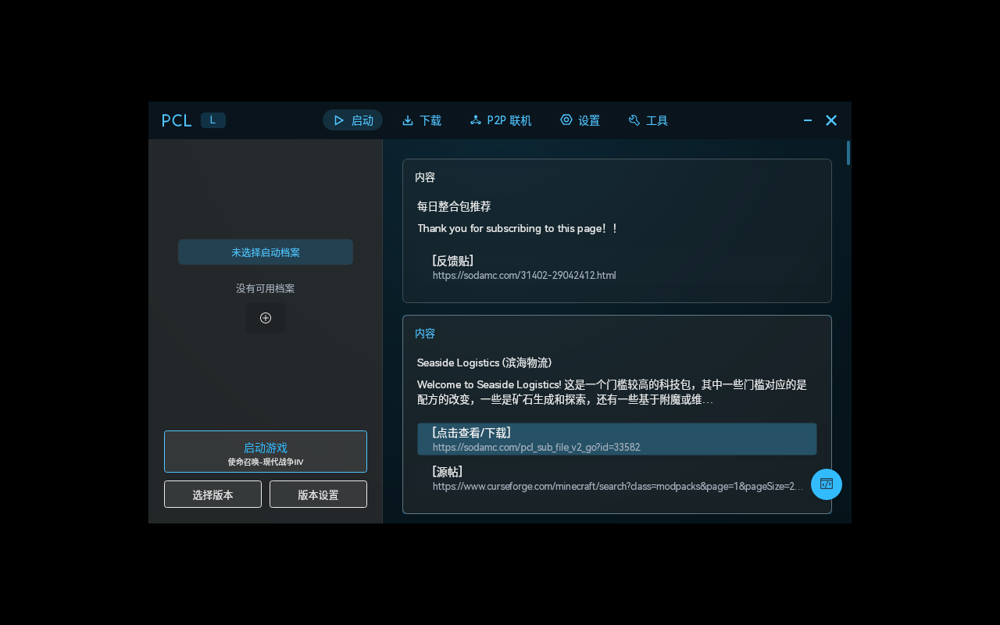
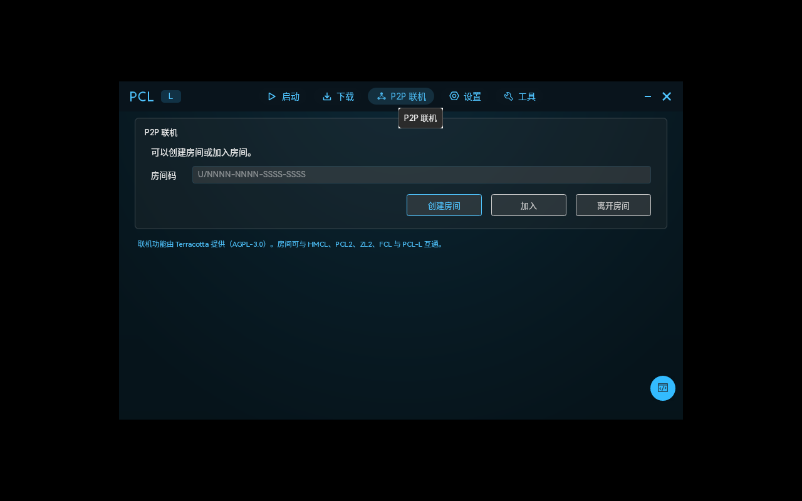
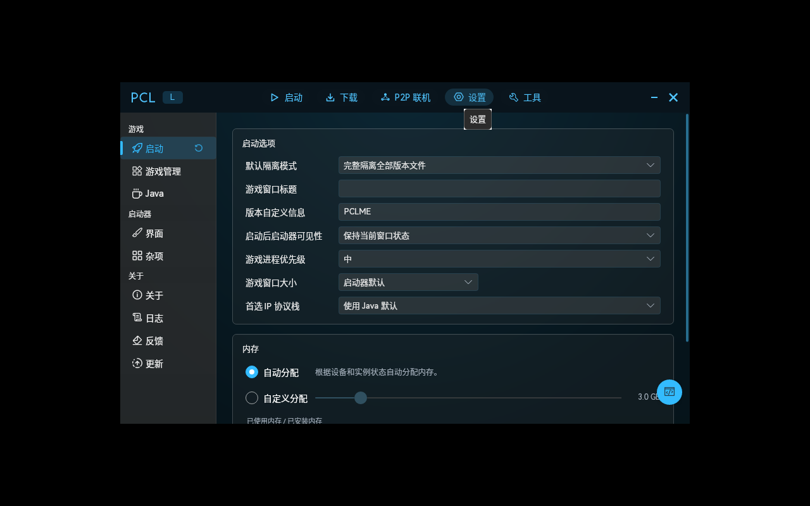

# PCL-L

<p align="center">
  
</p>

<p align="center">
  <b>PCL-L</b> — a Linux build of PCL based on PCL-CE.<br/>
  The familiar PCL interface, packaged for Debian, Fedora, Arch and more.
</p>



## Download

| Distribution | File |
| --- | --- |
| Debian / Ubuntu / Mint / Pop!_OS / Deepin | `PCL-L-1.0.0-amd64.deb` |
| Fedora / RHEL / Rocky / AlmaLinux / openSUSE | `PCL-L-1.0.0-1.x86_64.rpm` |
| Arch / Manjaro / EndeavourOS | `PCL-L-1.0.0-1-x86_64.pkg.tar.zst` |
| Any distribution (single file) | `PCL-L-1.0.0-x86_64.AppImage` |
| Any distribution (portable) | `PCL-L-1.0.0-linux-x64-portable.tar.gz` |

All files are published on [Releases](https://github.com/135hshsjsv/PCL-L/releases). Verify with `sha256sum -c SHA256SUMS`.

## Install

```bash
sudo apt install ./PCL-L-1.0.0-amd64.deb        # Debian-based
sudo dnf install ./PCL-L-1.0.0-1.x86_64.rpm      # Fedora-based
sudo zypper install ./PCL-L-1.0.0-1.x86_64.rpm   # openSUSE
sudo pacman -U PCL-L-1.0.0-1-x86_64.pkg.tar.zst  # Arch-based

chmod +x PCL-L-1.0.0-x86_64.AppImage && ./PCL-L-1.0.0-x86_64.AppImage
```

The launcher installs to `/opt/pcl-l`, the desktop entry is `pcl-l.desktop` and the menu name is **PCL-L**.

## Requirements

.NET 10 is bundled. System packages: `libc6`, `libicu`, `libssl3`, `zlib1g`, `libfontconfig1`, `libfreetype6`, `libx11-6`, `libice6`, `libsm6`, `libxrandr2`, `libxi6`, `libgl1`, `libglib2.0-0`.

Minecraft itself needs Java — let the launcher download it, or install `jre21-openjdk` / `openjdk-21-jre` / `java-21-openjdk` for your distribution.

## Features



- **Version management**: vanilla, Forge, NeoForge, Fabric, Quilt, LiteLoader, OptiFine, Cleanroom and their companion APIs
- **P2P multiplayer**: built-in [Terracotta](https://github.com/burningtnt/Terracotta); rooms interoperate with HMCL, PCL2, ZL2, FCL and PCL-L, no public IP needed
- **Resource downloads**: Modrinth and CurseForge, for mods, modpacks, resource packs, shaders and worlds
- **Instance repair**: missing-file recovery, dependency checks, crash analysis
- **Download sources and proxy**: official/mirror switching, HTTP proxy, DNS over HTTPS

## Differences from upstream

- Product name, window title and desktop entry unified as **PCL-L**, with a new ice-blue hexagonal icon
- Colour palette shifted from PCL blue to ice-blue/cyan (`Desktop/Styles/Colors.axaml`)
- New `FrontendLinuxDistributionService` reading `/etc/os-release` to detect Debian / Fedora / Arch / openSUSE families
- New "System information" toolbox action and settings card, showing distribution, package manager and the matching Java install command
- Localization kept in sync across 8 locales



## Build from source

```bash
dotnet publish PCL.Frontend.Avalonia/PCL.Frontend.Avalonia.csproj \
  -c Release -r linux-x64 --self-contained true -o out

./packaging/build-deb.sh out dist
./packaging/build-rpm.sh out dist
cd packaging/arch && PCL_PAYLOAD=$PWD/../../out makepkg -f --nodeps
```

## Known limitations

- The AppImage requires FUSE2; on FUSE3-only systems such as Ubuntu 24.04 install `libfuse2t64` or run with `--appimage-extract-and-run`
- The tray icon is not shown in some desktop environments without an AppIndicator extension

## Credits

- [Plain Craft Launcher](https://github.com/Meloong-Git/PCL) by 龙腾猫跃
- [PCL-CE](https://github.com/PCL-Community/PCL-CE), the community edition this project is based on
- [Terracotta](https://github.com/burningtnt/Terracotta) (AGPL-3.0-or-later) for P2P multiplayer
- All contributors in the PCL ecosystem

## License

The launcher logic is Apache-2.0; `PCL.Frontend.Avalonia/` keeps PCL-CE's custom licence. Multiplayer is based on Terracotta (AGPL-3.0-or-later). See `LICENSE`.

This launcher is built on PCL-CE. Any rights holder may request removal.
