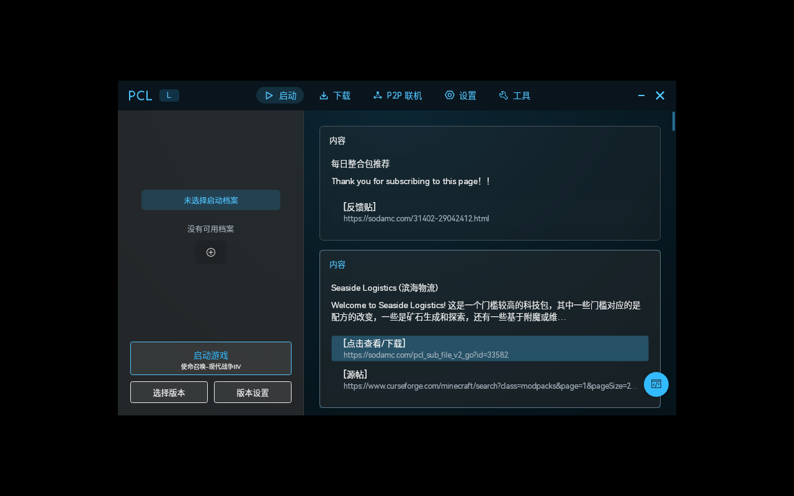
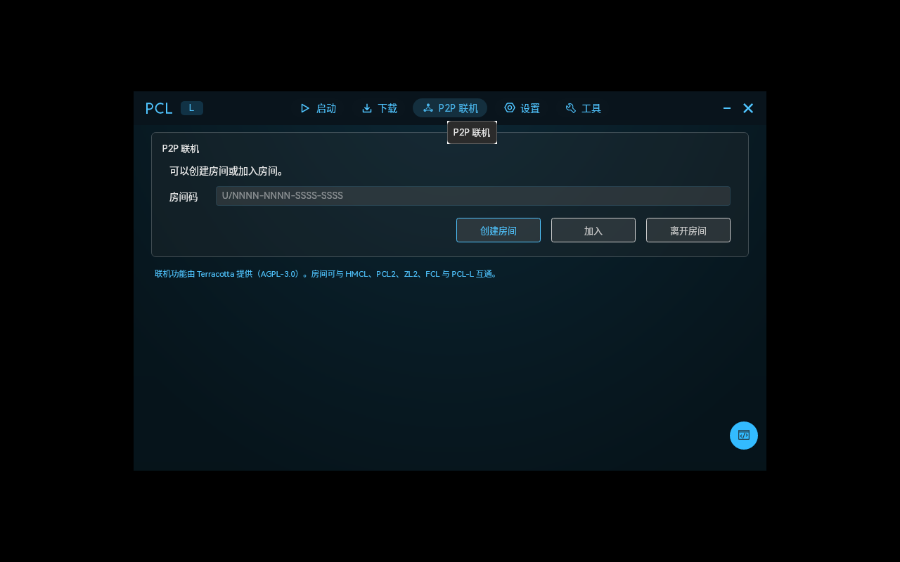
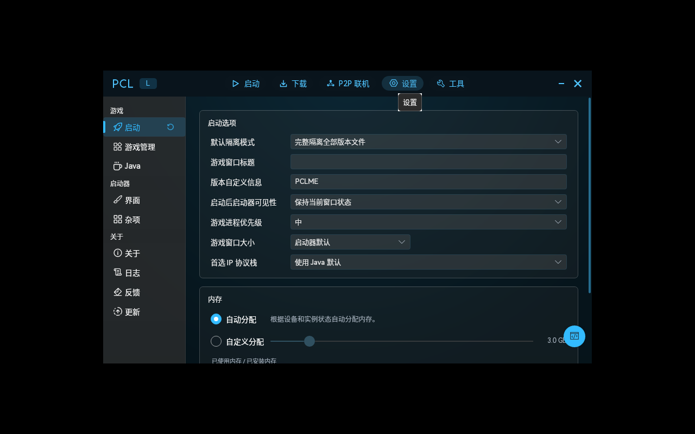

# PCL-L

<p align="center">
  
</p>

<p align="center">
  <b>PCL-L</b> —— 基于 PCL-CE 打造的 Linux 版 PCL 启动器。<br/>
  熟悉的 PCL 界面与操作，补上 Debian / Fedora / Arch 等主流发行版的安装包。
</p>



## 下载

| 发行版 | 文件 |
| --- | --- |
| Debian / Ubuntu / Mint / Pop!_OS / Deepin | `PCL-L-1.0.1-amd64.deb` |
| Fedora / RHEL / Rocky / AlmaLinux / openSUSE | `PCL-L-1.0.1-1.x86_64.rpm` |
| Arch / Manjaro / EndeavourOS | `PCL-L-1.0.1-1-x86_64.pkg.tar.zst` |
| 任意发行版（单文件） | `PCL-L-1.0.1-x86_64.AppImage` |
| 任意发行版（解压即用） | `PCL-L-1.0.1-linux-x64-portable.tar.gz` |

以上文件在 [Releases](https://github.com/135hshsjsv/PCL-L/releases) 中提供，校验用 `sha256sum -c SHA256SUMS`。

## 安装

```bash
# Debian 系
sudo apt install ./PCL-L-1.0.1-amd64.deb

# Fedora / RHEL 系
sudo dnf install ./PCL-L-1.0.1-1.x86_64.rpm

# openSUSE
sudo zypper install ./PCL-L-1.0.1-1.x86_64.rpm

# Arch 系
sudo pacman -U PCL-L-1.0.1-1-x86_64.pkg.tar.zst

# AppImage（需要 FUSE2；无 FUSE 时加 --appimage-extract-and-run）
chmod +x PCL-L-1.0.1-x86_64.AppImage
./PCL-L-1.0.1-x86_64.AppImage

# 免安装
tar -xzf PCL-L-1.0.1-linux-x64-portable.tar.gz -C ~/PCL-L
~/PCL-L/PCL.Frontend.Avalonia
```

安装后从应用菜单启动 **PCL-L**，程序位于 `/opt/pcl-l`，桌面项 `pcl-l.desktop`，图标 `pcl-l.png`。

## 运行依赖

程序自带 .NET 10 运行时，不需要另装 .NET。系统包依赖：

`libc6`、`libicu`、`libssl3`、`zlib1g`、`libfontconfig1`、`libfreetype6`、`libx11-6`、`libice6`、`libsm6`、`libxrandr2`、`libxi6`、`libgl1`、`libglib2.0-0`

游戏本身需要 Java，可用启动器内置下载，或按发行版安装：

```bash
sudo pacman -S jre21-openjdk      # Arch
sudo apt install openjdk-21-jre   # Debian 系
sudo dnf install java-21-openjdk  # Fedora 系
```

## 功能



- **版本管理**：原版、Forge、NeoForge、Fabric、Quilt、LiteLoader、OptiFine、Cleanroom 及各配套 API 一键安装
- **P2P 联机**：内置 [Terracotta](https://github.com/burningtnt/Terracotta)，房间可与 HMCL、PCL2、ZL2、FCL、PCL-L 互通，无需公网 IP
- **资源下载**：Modrinth / CurseForge 双源，模组、整合包、资源包、光影、世界，支持中文关键词搜索（自动映射为英文检索词）
- **实例修复**：缺失文件补全、依赖检查、崩溃分析
- **下载源与代理**：官方源 / 镜像源切换，HTTP 代理、DNS over HTTPS

## 相对上游的改动

- 产品名、窗口标题、桌面入口统一为 **PCL-L**，图标为冰蓝六边形徽标
- 界面配色整体从 PCL 蓝调整为冰蓝／青色系（`Desktop/Styles/Colors.axaml` 的 Blue 色阶重新映射）
- 新增 `FrontendLinuxDistributionService`：读取 `/etc/os-release` 识别 Debian 系 / Fedora 系 / Arch 系 / openSUSE
- 工具 → 百宝箱新增「系统信息」，设置 → 杂项新增「系统信息」卡片，显示发行版、包管理器与对应 Java 安装命令
- 8 种语言（en-US / zh-Hans / zh-Hant / de-DE / es-ES / fr-FR / ko-KR / lzh）文案同步



## 从源码构建

```bash
dotnet publish PCL.Frontend.Avalonia/PCL.Frontend.Avalonia.csproj \
  -c Release -r linux-x64 --self-contained true -o out

# 生成安装包
./packaging/build-deb.sh out dist
./packaging/build-rpm.sh out dist
cd packaging/arch && PCL_PAYLOAD=$PWD/../../out makepkg -f --nodeps
```

## 已知限制

- AppImage 依赖 FUSE2；Ubuntu 24.04 等只带 FUSE3 的发行版需要 `libfuse2t64`，或直接用 `--appimage-extract-and-run`
- 托盘图标在部分桌面环境（GNOME 未装 AppIndicator 扩展时）不显示，属桌面环境限制

## 致谢

- [Plain Craft Launcher](https://github.com/Meloong-Git/PCL) —— 龙腾猫跃，PCL 的原作者
- [PCL-CE](https://github.com/PCL-Community/PCL-CE) —— PCL 社区版，本项目的基础
- [Terracotta](https://github.com/burningtnt/Terracotta) —— 陶瓦联机（AGPL-3.0-or-later）
- 以及所有为 PCL 生态做出贡献的开发者

## 许可证与免责

上游逻辑部分为 Apache-2.0，`PCL.Frontend.Avalonia/` 沿用 PCL-CE 的自定义许可；联机功能基于 Terracotta（AGPL-3.0-or-later）。详见 `LICENSE`。

本启动器基于 PCL-CE 打造，如有侵权等立删。
